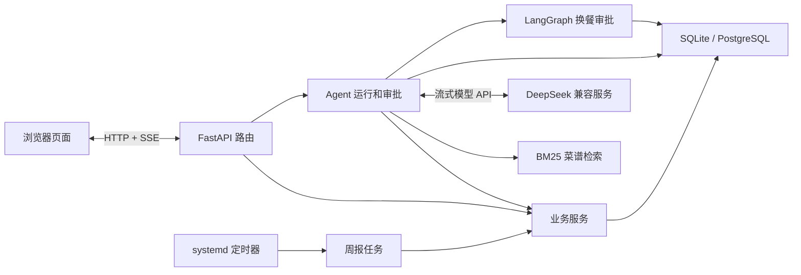

# 食光管家技术说明

食光管家是一套面向个人和家庭的中文 Web 应用。它把食材批次、菜单、采购、烹饪、记餐和习惯放进同一个工作流。AI 管家可以读取库存和菜谱参考，给出做法或提出菜单修改，业务变更经过用户审批。

本文介绍食光管家的源码与部署。单机默认使用 SQLite，PostgreSQL 支持持久化的换餐审批工作流。

## 技术栈

| 层次 | 技术 | 作用 |
| --- | --- | --- |
| 浏览器 | HTML、CSS、原生 JavaScript、原生 SVG、markdown-it | 响应式页面、焦橙主题、餐盘交互、菜单时间线和流式对话。 |
| API | Python、FastAPI、Uvicorn、Pydantic | HTTP 请求校验、接口路由、OpenAPI 文档和同源静态文件服务。 |
| 数据 | SQLite、PostgreSQL、SQLAlchemy、Alembic | 持久化业务数据、会话与事件，管理建表和升级。 |
| AI | DeepSeek 兼容接口、LangChain（`langchain-openai`）、SSE | 模型适配、上下文和流式回答。 |
| 审批 | LangGraph、PostgresSaver、业务服务 | 保存 PostgreSQL 换餐修改单的待审批状态，恢复后按用户决定提交。 |
| 检索 | Python 实现的 BM25 | 查询中文菜谱与饮食参考，并为回答附来源。 |
| 后台与部署 | Ubuntu VM、systemd timer、Python 任务脚本 | 8014 单端口服务和按授权自动生成周报。 |
| 验证 | pytest、FastAPI TestClient、SQLite、PostgreSQL、前端冒烟检查、浏览器联调 | 验证关键业务分支、审批恢复、显示和交互。 |

## 关键实现

### 从菜单到库存与周报

库存按批次保存数量、单位和到期日，消费或入库以流水记录并由服务端做幂等和余额验证。菜单采用不可变版本，更新时比对当前版本，恢复旧菜单会生成一个新版本。记餐记录同时保存来源、餐次和计划标记。菜单根据计划标记显示「已吃」，周报按计划餐次和记录日期重新统计。烹饪消耗须单独确认。涉及数量和营养的计算使用 Decimal，缺失的营养或习惯数据按缺失显示。

### 会话、事件和数据库事务

服务端通过 LangChain 的 `ChatOpenAI` 调用 DeepSeek 兼容文本接口。模型提供方按增量返回回复。服务端保存运行和事件序号，通过 SSE 发送消息增量与完成状态，浏览器在同一个回复气泡持续显示，并在刷新后从会话历史恢复。服务端提交短事务后等待模型，收到进度时再写事件，减少 SQLite 写锁对其它请求的影响。规则模式能处理库存、菜谱和计划等确定性场景。用户可以配置人设和主记忆，引用消息或选择旁支，开启团队协作后由顾问提供建议并由管家汇总。

### 检索和审批

BM25 支持中文单字、双字和英文词匹配。检索参考包括内置菜谱、公开资料及按账号过滤的知识。HowToCook 的菜谱与说明有随项目保留的来源及许可文件。CookLikeHOC 在本项目里提供菜名、分类与原始链接。回答把库存事实、结构化营养数据和外部参考区分开。提出修改、用户决定和提交业务数据是独立步骤。提交前核对操作所属账号、载荷哈希、版本和业务约束。

PostgreSQL 的换餐提议通过 `interrupt()` 暂停。重启后，审批接口使用该修改单的检查点和 `Command(resume=...)` 继续。审批恢复、版本校验及业务写入使用同一事务，处理中断时可以用原修改单重试。SQLite 与已有修改单继续使用原有审批入口。[LangGraph 审批中断](https://docs.langchain.com/oss/python/langgraph/interrupts)

### 权限和自动周报

登录使用会话 Cookie，写接口检查 CSRF。业务查询按用户 ID 隔离。整库备份与恢复由服务端管理员授权文件控制，恢复会先保存当前库，并保留管理员账号。自动周报按每周日北京时间 20:00 执行。任务复用手动生成的统计逻辑，只处理授权为「自动」的活跃账号，并按用户和周次防止重复通知。

## 关键代码入口

| 功能 | 文件 |
| --- | --- |
| 页面、主题与交互 | `frontend/app.js`、`frontend/styles.css`、`frontend/chat-ui.js` |
| 业务规则与营养计算 | `backend/app/application/services.py` |
| 会话、SSE、审批 | `backend/app/api/v1/agent.py`、`backend/app/agents/engine.py` |
| 模型适配、换餐审批恢复 | `backend/app/agents/llm.py`、`backend/app/agents/meal_approval.py` |
| 菜谱检索与来源 | `backend/app/rag/bm25.py`、[资料来源](../backend/app/rag/data/SOURCES.md) |
| 管理员权限和备份 | `backend/app/core/administration.py`、`backend/app/api/v1/privacy.py` |
| 自动周报 | `backend/app/application/weekly_reports.py`、`scripts/run_weekly_reports.py` |
| 单机启动与部署 | `scripts/run_local.py`、[Linux 部署与运维](../deploy/LOCAL_LINUX.md) |

## 发布与验证

8014 运行版使用 FastAPI 同源托管页面和 API，SQLite 保存在 VM，自动周报的 systemd 定时器已启用。配色发布前对 11 个页面做了桌面和手机宽度检查，覆盖浅色和深色模式，也走过记餐弹窗、规则模式对话和美食转盘。

单机交付在 Windows 和 Ubuntu 分别验证了 Python 3.12 启动和 SQLite 迁移。Windows 浏览器实测了演示登录、主题、会话刷新、周报和转盘，前端 17 项检查通过。单机后端回归覆盖库存幂等、跨账号隔离、审批拒绝、版本冲突、营养单位、SQLite 事务、备份恢复和定时任务。

本地源码通过 28 项常规后端测试和 1 项 PostgreSQL 集成测试。独立 PostgreSQL 测试库验证了待审批恢复、进程中断后的重试、并发重复审批和版本冲突。LangChain 文本调用与流式输出通过模拟兼容接口测试。真实 DeepSeek 账号联调与 Compose 整套部署仍待验证。[后端验证方法](../backend/README.md#postgresql-换餐审批)
